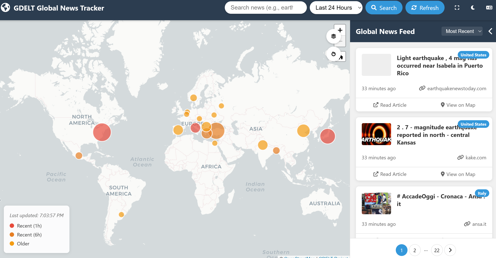

# GDELT Global News Tracker



An interactive web app that plots live news coverage on a world map. Type a topic such as `earthquake` or `climate change`, pick a time window, and the app shows where in the world that story is being reported — as markers on a Leaflet map next to a browsable headline feed — using data from the [GDELT Project](https://www.gdeltproject.org/) (Global Database of Events, Language, and Tone).

## Who it is for

- Anyone who wants a quick geographic picture of a breaking story: where it is being covered, how recently, and by which outlets.
- Journalists, researchers, and students exploring media coverage patterns without writing code or querying the GDELT API directly.
- Developers who want a small, readable example of a PHP + Python bridge in front of the GDELT DOC API — there is no framework, build step, or database to learn first.

## Features

- **Live map of news activity** — articles grouped by source country and drawn as sized, colour-coded markers (larger = more coverage; red/orange/yellow = more recent). Click a marker cluster or country marker to read its headlines.
- **Keyword + time-range search** — free-text query with suggestions (earthquake, climate change, election, …) and windows of the last hour, 6 hours, 24 hours (default), 3 days, or 7 days.
- **Headline feed** — paginated article list (10 per page) sortable by recency, relevance score, or country. Hovering a headline focuses the map; clicking a country marker opens a per-country modal.
- **Visualization modes** — standard country markers or clustered markers (Leaflet.markercluster). A heatmap button is present in the UI, but the Leaflet.heat plugin is not bundled, so selecting it shows a notice and falls back to standard markers.
- **Share and export** — copy a link that encodes the current query in the URL (`?q=…&timespan=…&country=…`), share to social media, or download the current result set as CSV or JSON.
- **Dark mode and fullscreen** — theme toggle persisted in the browser, CARTO light/dark basemaps to match, plus a fullscreen toggle and collapsible feed for small screens.
- **Translation module** — `translate.js` adds Google Translate–based language detection and selective translation of foreign-language headlines. See [Translation](#translation) — it is shipped in the repo but not loaded by default.
- **Welcome guide** — first-visit walkthrough modal (dismissible permanently via “Don’t show this again”).

## Quick start

The app is plain PHP pages + static assets with a small Python helper. There is nothing to compile and no database to set up.

### Prerequisites

| Requirement | Why | Check |
|---|---|---|
| PHP (CLI + web SAPI) with `proc_open` enabled | Serves `index.php` and the `get_news.php` JSON endpoint, which launches the Python helper | `php -v` |
| Python 3 available as `python` on `PATH` | `get_news.php` runs `python src/gdelt.py …` — the binary name is literally `python` | `python --version` |
| Python packages `pandas` and `gdeltdoc` | `src/gdelt.py` imports both; `gdeltdoc` is the client for the GDELT DOC API | see install step below |
| Internet access at runtime | `gdeltdoc` queries the GDELT DOC API; the page loads Leaflet, Font Awesome, and map tiles from CDNs | — |

No GDELT API key is required — nothing in the codebase reads an API key or credential file.

### Install and run (local)

```bash
git clone https://github.com/faratech/gdelt-tracker.git
cd gdelt-tracker
python -m pip install pandas gdeltdoc
php -S localhost:8000
```

Then open [http://localhost:8000/](http://localhost:8000/) in a browser.

Notes on why it is run exactly this way:

- Run the PHP server **from the repository root**. `get_news.php` invokes `src/gdelt.py` by relative path, so the working directory/docroot must be the repo root.
- `php -S` is PHP’s built-in development server — fine for local use. For a public deployment, serve the same directory with Apache (the included `.htaccess` applies) or any web server that can execute PHP, with the repo root as docroot.
- The first search defaults to `earthquake` over the last 24 hours. If the feed reports “Failed to load news data”, the Python dependencies are the first thing to check (see [Troubleshooting](#troubleshooting)).

### Verify it works

With the server running:

```bash
curl http://localhost:8000/index.php        # 200, HTML page containing the Leaflet map
curl 'http://localhost:8000/get_news.php?q=earthquake&timespan=24h'   # JSON: {"status":"success", … "data":[…]}
```

A successful `get_news.php` response contains `status`, `timestamp`, the echoed `query`, `totalResults`, and a `data` array of articles. An empty result set returns `{"status":"empty", …}` instead of an error.

## Usage

1. **Search.** Enter a keyword and choose a time range, then press Search (or hit Refresh to re-run the current query). The URL updates to match, so the view can be bookmarked or shared.
2. **Read the map.** Marker size grows with the number of articles from that country (log-scaled); colour encodes recency — red within the last hour, orange within 6 hours, yellow for older items (see the on-map legend). Use the home button to reset the view, and the layer/fire buttons to switch between marker and clustered views.
3. **Browse headlines.** The right-hand feed lists articles 10 at a time. Sort by *Most Recent*, *Relevance*, or *Country*. Click a country marker (or cluster popup) to open the country modal with its full article list and pagination.
4. **Share or export.** From the country modal, open the share dialog to copy a link to the current view, download CSV/JSON, or post to Twitter/Facebook/LinkedIn/email.
5. **Display options.** Moon/sun button toggles dark mode (remembered between visits); expand button toggles fullscreen; the chevron collapses the feed to give the map full width.

## How it works

```
Browser (index.php + script.js)
   │  fetch get_news.php?q=<keyword>&timespan=<range>[&country=<name>]
   ▼
get_news.php  ── validates input, rate-limits, caps concurrency
   │  exec python src/gdelt.py "<keyword>" "<timespan>" ["<country>"]
   ▼
src/gdelt.py  ── gdeltdoc → GDELT DOC API (article_search, up to 250 records)
   │  pandas: de-duplicate, sort, relevance-score → JSON on stdout
   ▼
get_news.php wraps the JSON with status/timestamp/query metadata
   ▼
script.js renders Leaflet markers + headline feed
```

Details worth knowing:

- **Data source.** `src/gdelt.py` uses `gdeltdoc.GdeltDoc().article_search()` with a `Filters(keyword=…, timespan=…, num_records=250)` query against the GDELT DOC API. No other upstream service is called by the backend.
- **Cleaning and ranking.** The Python helper drops duplicate URLs and titles, sorts by `seendate`, then computes a `relevance_score` (0–10): exact keyword matches in the title score highest, then title term matches, then body/excerpt matches. Results are returned relevance-first, and the UI can re-sort by time or country.
- **Where markers land.** Articles carry a `sourcecountry` from GDELT. `script.js` looks that name up in [`capitals.json`](capitals.json) — 52 country → capital `[latitude, longitude]` entries — and places the marker at the capital. Countries absent from `capitals.json` are not plotted, and `get_news.php` rejects a `country` filter that is not in that file.
- **Frontend stack.** [`index.php`](index.php) is the only page. It loads Leaflet 1.9.4 and Leaflet.markercluster 1.5.3 from unpkg (pinned with Subresource Integrity hashes), Font Awesome 6 from cdnjs, and CARTO basemap tiles. All application logic lives in [`script.js`](script.js); styling in [`style.css`](style.css). There is no bundler or transpiler.

## The `get_news.php` endpoint

`GET get_news.php` is the app’s only backend route. It is same-origin only by design (no CORS headers are sent).

| Parameter | Required | Values | Default |
|---|---|---|---|
| `q` | no | Free text, max 200 characters | `earthquake` |
| `timespan` | no | `1h`, `6h`, `24h`, `3d`, `7d` (anything else falls back to the default) | `24h` |
| `country` | no | Exact key from `capitals.json`, e.g. `France` | none (all countries) |

Behaviour and errors (JSON in all cases):

- `200` with `status: "success"` and the article array, or `status: "empty"` when nothing matches.
- `400` for an over-long search term, a NUL byte in `q`, or an unknown `country`.
- `405` for non-GET requests.
- `429` when the per-IP rate limit is exceeded (with a `Retry-After` header).
- `503` when all Python worker slots are busy; `500`/`504` when the Python helper fails or times out. Error responses include a short `requestId` that matches the server-side log entry — the Python traceback itself is logged, never sent to the browser.

## Configuration

There is no config file and no `.env`. The only configuration surface is four environment variables read by `get_news.php`, plus two data files you can edit directly.

| Environment variable | Default | Purpose |
|---|---|---|
| `GDELT_SCRIPT_TIMEOUT` | `25` (seconds) | Kills `src/gdelt.py` if a single query runs longer than this |
| `GDELT_MAX_CONCURRENT` | `4` | Maximum simultaneous Python helper processes; extra requests get `503` |
| `GDELT_RATE_LIMIT` | `20` requests / 60 s per IP | Fixed-window per-client limit; excess requests get `429` |
| `GDELT_STATE_DIR` | `<system temp>/gdelt-tracker-<hash of install path>` | Directory for rate-limit counters and concurrency lock files. Must be writable by the web server; set it explicitly if the default temp location is not |

Example — allow longer queries and more parallelism for a busy host:

```bash
GDELT_SCRIPT_TIMEOUT=40 GDELT_MAX_CONCURRENT=8 php -S localhost:8000
```

(Under Apache, set the same variables with `SetEnv` in the server/virtual-host config instead.)

Editable data files:

- [`capitals.json`](capitals.json) — add a `"Country Name": [lat, lng]` entry to plot an additional country or to make it valid for the `country` filter. Keys must match the `sourcecountry` strings returned by GDELT.
- [`.htaccess`](.htaccess) — Apache-only cache-defeating rules (for Apache/mod_headers/mod_expires/LiteSpeed/Cloudflare-fronted hosts). It is ignored by `php -S` and is not required for local development.

Other behaviour is fixed in code: the 250-record fetch cap and relevance weighting in `src/gdelt.py`, and the default query (`earthquake`, `24h`) shared by `index.php`, `get_news.php`, and `src/gdelt.py`.

## Translation

[`translate.js`](translate.js) is a self-contained translation module built on the Google Translate widget:

- It loads `//translate.google.com/translate_a/element.js`, detects the language of headline text (Google’s detector when available, with a character-set fallback covering Russian, Chinese, Japanese, Korean, Arabic, Hebrew, Thai, and Greek), and groups non-English articles by language.
- A small floating panel offers *Detect Languages*, per-language *Translate* buttons, and an *Auto-detect* toggle. Preferences persist in `localStorage` (`lastTranslateLanguage`, `autoTranslateDisabled`), and a `MutationObserver` re-scans the feed whenever new articles render, so dynamically loaded headlines are covered. The original page layout is left in place — translation happens in the rendered text.

**Current wiring:** `index.php` renders the translation toggle button (the globe/language icon in the header) and `script.js` toggles the panel’s visibility, but `index.php` does **not** currently include `translate.js`, so the panel is only created if you load it. To enable translation, add this line next to the existing `script.js` include at the end of `index.php`:

```html
<script src="translate.js"></script>
```

An internet connection is required for Google Translate, exactly as for the map CDNs.

## Project layout

```
.
├── index.php          # Single page: header/search, Leaflet map container, feed, modals
├── get_news.php       # JSON endpoint: validation, rate limit, concurrency cap, runs the Python helper
├── script.js          # All frontend logic: fetching, Leaflet markers/clusters, feed, export/share, theme
├── style.css          # Page, map, feed, modal, and dark-mode styles
├── translate.js       # Optional Google Translate detection/translation module (not loaded by default)
├── capitals.json      # 52 country → capital [lat, lng] entries; map placement + country-filter validation
├── src/
│   └── gdelt.py       # GDELT DOC query via gdeltdoc + pandas cleaning/relevance scoring → JSON stdout
├── assets/
│   └── ui.png         # Interface screenshot shown above
├── .htaccess          # Apache cache-disabling rules (production/Apache only)
├── LICENSE            # MIT License
└── README.md
```

## Development notes

- **No build step.** Edit the PHP/JS/CSS/Python files and reload. The CDN assets are pinned by version with SRI hashes in `index.php` — if you bump a Leaflet version there, update its `integrity` hash too.
- **Run the backend helper directly** to debug query behaviour without the web layer:
  ```bash
  python src/gdelt.py "earthquake" "24h"
  python src/gdelt.py "election" "7d" "France"
  ```
  Articles are printed as a JSON array on stdout; diagnostics and tracebacks go to stderr, and the exit code is non-zero on failure.
- **State on disk.** `get_news.php` keeps only rate-limit counters and lock files in `GDELT_STATE_DIR` — no database, no article cache. Every search is a fresh upstream GDELT query, so repeated identical searches cost the same as the first.
- **Security posture (by design).** Input is length-capped and whitelist-validated, shell arguments are escaped, article HTML is escaped and URLs restricted to http(s) in `script.js`, and backend errors return an opaque `requestId` instead of tracebacks. Keep `proc_open` available to PHP and keep the state directory writable, or the endpoint will return `503`.
- There are currently no automated tests or `requirements.txt` in the repo; the dependency list above is derived from the imports in `src/gdelt.py` (`pandas`, `gdeltdoc`, plus the standard library).

## Troubleshooting

| Symptom | Likely cause and fix |
|---|---|
| Feed shows “Failed to load news data”, endpoint returns `500` | Python deps missing or `python` not on the web server’s `PATH`. Install with `python -m pip install pandas gdeltdoc` for the same interpreter the server invokes, then check the PHP error log for the `requestId` line. The same symptom occurs when the upstream GDELT DOC API rate-limits your host (the log shows `gdeltdoc.errors.RateLimitError`) — wait a minute and retry. |
| Endpoint returns `503` “news service is busy” | All `GDELT_MAX_CONCURRENT` slots are busy, or `GDELT_STATE_DIR` is not writable. Raise the cap or point `GDELT_STATE_DIR` at a writable directory. |
| Endpoint returns `429` | Per-IP `GDELT_RATE_LIMIT` (20/min default) exceeded — wait for the `Retry-After` interval or raise the limit. |
| Map renders but no markers | Results were empty (`status: "empty"`), or returned countries are missing from `capitals.json`. Try a broader keyword/time range. |
| Heatmap button appears to do nothing | Expected: Leaflet.heat is not bundled, so the app warns and falls back to markers. Clustered view is the alternative grouping mode. |
| Translation panel never appears | `translate.js` is not included by `index.php` by default — add the `<script>` tag shown in [Translation](#translation). |

## License

[MIT License](LICENSE) — Copyright (c) 2025 Mike Fara. You may use, copy, modify, and distribute this software under the terms in the `LICENSE` file. News data is provided by the [GDELT Project](https://www.gdeltproject.org/); map tiles © OpenStreetMap contributors via CARTO.
